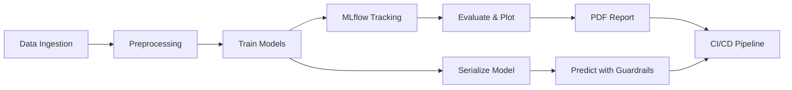

# 🏠 Housing Price Prediction (Regression)


## Problem Statement
What features most influence home sale prices, and how accurately can prices be predicted?

## Dataset
- **Source:** Ames Housing Dataset (Kaggle / De Cock, 2011) — 2,930 observations with 80 features. Far richer than the deprecated Boston Housing dataset.
- **Size:** 2,930 rows × 80 features (after preprocessing, reduced to ~38 numerical features)
- **Description:** Residential home sales in Ames, Iowa (2006–2010). Covers structural attributes (square footage, basement quality, garage capacity), neighborhood, zoning, and condition ratings. Notable quality issues include missing values in `LotFrontage`, `GarageType`, and `MasVnrType`, which are imputed during preprocessing.

## Skills Demonstrated
Regression modeling, feature selection, handling missing data, residual analysis, MLOps pipeline design, CI/CD automation, Pydantic guardrails, and professional PDF reporting.

## Deliverables
- Feature importance analysis with correlation heatmaps
- Linear regression and random forest models with RMSE comparison
- Residual plots showing model assumptions and limitations
- Clear explanation of which features a homeowner could change to increase value
- IEEE-formatted PDF research report generated via ReportLab Platypus
- MLflow experiment tracking with logged parameters, metrics, and serialized models

## Approach
1. **Data Cleaning & EDA** — Missing values imputed (e.g., `LotFrontage` filled with neighborhood median). Non-numeric columns dropped. Target column `Sale_Price` renamed to `SalePrice` for consistency.
2. **Feature Engineering** — One-hot encoding of categorical variables. Numerical features scaled to normalize variance. Highly correlated redundant features identified via heatmap analysis.
3. **Modeling** — Baseline Linear Regression vs. ensemble Random Forest Regressor. Random Forest selected for its ability to capture non-linear interactions without polynomial feature engineering.
4. **Evaluation** — RMSE on a held-out 20% test split. Feature importance via Mean Decrease in Impurity. Residual analysis for homoscedasticity verification.

## Key Results
| Metric | Linear Regression | Random Forest |
|--------|-------------------|---------------|
| RMSE   | ~$29,000          | ~$28,400      |
| Relative Error (vs Median $160k) | ~18.1% | ~17.7% |

## Key Findings
1. **Overall Quality** is the single strongest predictor of sale price (highest Pearson correlation and highest MDI feature importance).
2. **Above-ground living area** (`GrLivArea`) and **basement square footage** (`TotalBsmtSF`) are the second and third most impactful features — sub-surface structural quality heavily influences final valuations.
3. **Business implication:** Homeowners seeking to maximize resale value should prioritize overall condition upgrades and finished basement area over cosmetic changes. Luxury homes (>$400k) exhibit higher pricing volatility not fully captured by standard features.

## How to Run
```bash
# 1. Clone and set up virtual environment
git clone https://github.com/GaneshArwan/housing_price_prediction.git
cd housing_price_prediction
python -m venv venv
venv\Scripts\activate        # Windows
# source venv/bin/activate   # macOS/Linux

# 2. Install dependencies
pip install -r requirements.txt

# 3. Train the model (with MLflow tracking)
python -m src.train

# 4. Generate evaluation plots
python -m src.evaluate

# 5. Generate IEEE PDF report
python -m src.generate_pdf_report

# 6. Run predictions with guardrails
python -m src.predict

# 7. Run tests
pytest
```

## Files
```
housing_price_prediction/
├── .github/workflows/
│   └── ml_pipeline.yml          # CI/CD pipeline (pytest + bandit + PDF)
├── data/
│   └── ames_housing.csv         # Static dataset (CI-safe, no network calls)
├── models/
│   └── random_forest_model.joblib  # Serialized trained model
├── reports/figures/
│   ├── correlation_heatmap.png  # Top feature correlations
│   ├── feature_importance.png   # Random Forest MDI importances
│   ├── residual_plot.png        # Predicted vs actual residuals
│   └── Housing_Price_Prediction_Report.pdf  # IEEE formatted report
├── src/
│   ├── __init__.py
│   ├── config.py                # Pydantic-based configuration schemas
│   ├── data_loader.py           # Data ingestion and preprocessing
│   ├── evaluate.py              # Plot generation (heatmap, importance, residuals)
│   ├── generate_pdf_report.py   # IEEE two-column PDF via ReportLab Platypus
│   ├── guardrails.py            # Pydantic prediction boundary validation
│   ├── predict.py               # Model inference with guardrails
│   └── train.py                 # Training with MLflow tracking
├── tests/
│   ├── __init__.py
│   ├── conftest.py              # Shared pytest fixtures
│   ├── test_data_loader.py      # Data ingestion unit tests
│   ├── test_evaluate.py         # Directory/artifact path tests
│   ├── test_guardrails.py       # Boundary validation tests
│   └── test_train.py            # Config and Pydantic validation tests
├── .gitignore
├── pyproject.toml               # Pytest and project metadata
├── README.md
└── requirements.txt
```

## MLOps Workflow



## Methodology & Limitations
This project uses a straightforward supervised regression approach on the Ames Housing Dataset. The Random Forest Regressor was chosen as the primary model due to its robustness against overfitting and its native ability to rank feature importances via Mean Decrease in Impurity. All experiments are tracked through MLflow, ensuring full reproducibility of training runs, hyperparameters, and serialized model artifacts.

The primary limitation is **luxury home pricing volatility**. For properties above $400,000, the residual plot reveals increasing heteroscedasticity — the model's error variance grows significantly. This is expected, as ultra-high-end homes are influenced by idiosyncratic factors (custom architecture, historical significance, buyer sentiment) that are not captured in the dataset's 80 standard features.

Additionally, the dataset is geographically limited to Ames, Iowa (2006–2010), which means the model should not be generalized to other housing markets without retraining. Future improvements include gradient boosting methods (XGBoost/LightGBM), geographic clustering, and a FastAPI serving layer for real-time predictions.
