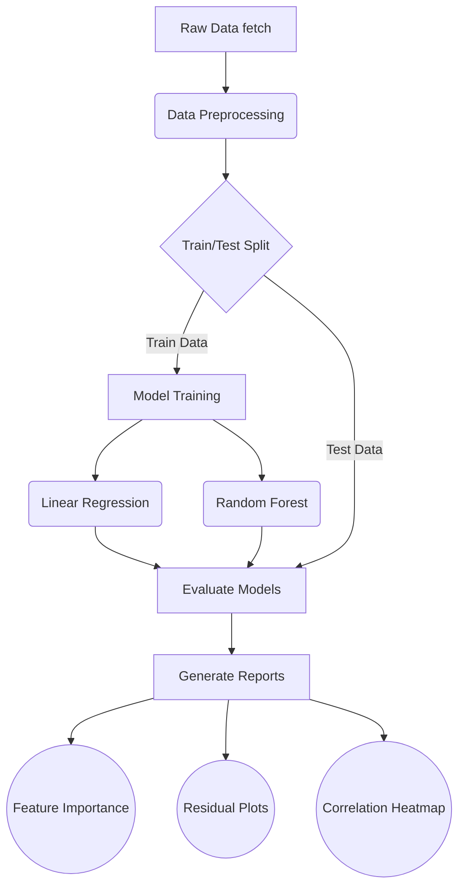

<div align="center">
  
# 🏡 Ames Housing Price Prediction 🚀

[](https://www.python.org/downloads/)
[](LICENSE)
[](https://scikit-learn.org/)
[](https://docs.pydantic.dev/)

*An end-to-end Machine Learning pipeline to predict house sale prices using the rich Ames Housing Dataset.*

</div>

---

## 🌟 Overview

What features most influence home sale prices, and how accurately can prices be predicted? This project answers these questions by exploring the Ames Housing Dataset (2,930 observations, 80 features) and building powerful predictive models like Random Forests and Linear Regression.

We take a **data-driven approach** to understand which features a homeowner could change to increase their property value, backed by statistical correlation heatmaps and feature importance analysis.

---

## 🏗️ Directory Breakdown

| Directory/File | Description |
| :--- | :--- |
| `src/` | Source code for the ML pipeline (`data_loader.py`, `train.py`, `evaluate.py`, `config.py`) |
| `data/` | Raw and processed datasets (ignored by git, automatically downloaded) |
| `notebooks/` | Jupyter notebooks for exploratory data analysis and visual insights |
| `reports/figures/` | Generated plots (feature importance, correlation heatmaps, residuals) |
| `requirements.txt` | Python dependencies required to run the pipeline |
| `venv/` | Isolated Python virtual environment (ignored by git) |
| `LICENSE` | Open-source MIT [License](LICENSE) |

---

## 🔄 Machine Learning Workflow

The pipeline is completely automated. Simply run the scripts to download data, train the models, and generate evaluation plots.



---

## 📊 Key Results

- **Linear Regression RMSE:** ~$29,000
- **Random Forest RMSE:** ~$28,400

Through our analysis, the most impactful features for home value are **Overall Quality**, **Living Area**, and **Basement/Garage Condition**. Homeowners should focus on these aspects for the best return on investment.

---

## 🚀 How to Run

1. **Set up the virtual environment:**
   ```bash
   python -m venv venv
   .\venv\Scripts\activate  # Windows
   pip install -r requirements.txt
   ```

2. **Train the models:**
   ```bash
   python -m src.train
   ```

3. **Evaluate and generate plots:**
   ```bash
   python -m src.evaluate
   ```

---
**License**: This project is licensed under the [MIT License](LICENSE).
