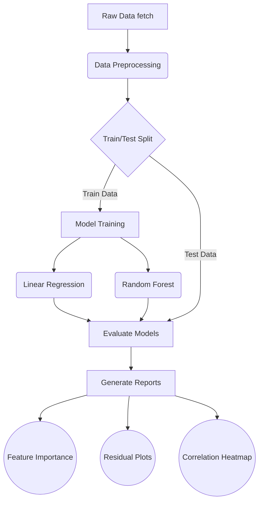

<div align="center">
  
# 🏡 Ames Housing Price Prediction 🚀

[](https://www.python.org/downloads/)
[](LICENSE)
[](https://scikit-learn.org/)
[](https://docs.pydantic.dev/)

*An end-to-end Machine Learning pipeline to predict house sale prices using the rich Ames Housing Dataset.*

</div>

---

## 🌟 Overview

What features most influence home sale prices, and how accurately can prices be predicted? This project answers these questions by exploring the Ames Housing Dataset (2,930 observations, 80 features) and building powerful predictive models like Random Forests and Linear Regression.

We take a **data-driven approach** to understand which features a homeowner could change to increase their property value, backed by statistical correlation heatmaps and feature importance analysis.

---

## 🏗️ Project Structure

```
housing_price_prediction/
├── .github/
│   └── workflows/
│       └── ml_pipeline.yml        # CI/CD pipeline (GitHub Actions)
├── data/
│   └── ames_housing.csv           # Ames Housing Dataset (2,930 rows)
├── models/
│   ├── linear_regression.joblib   # Serialized LR model
│   └── random_forest.joblib       # Serialized RF model
├── notebooks/
│   └── analysis.ipynb             # Exploratory data analysis
├── reports/
│   └── figures/
│       ├── feature_importance.png
│       ├── residual_plot.png
│       └── Housing_Price_Prediction_Report.pdf
├── src/
│   ├── config.py                  # Pydantic configuration & validation
│   ├── data_loader.py             # Data ingestion & preprocessing
│   ├── evaluate.py                # Metrics & visualization generation
│   ├── format_utils.py            # i18n currency formatting (Babel)
│   ├── generate_pdf_report.py     # Platypus PDF report generator
│   ├── guardrails.py              # Prediction value validation
│   └── train.py                   # Model training with MLflow tracking
├── tests/
│   ├── test_data_loader.py        # QA/QC: data pipeline tests
│   └── test_train.py              # QA/QC: config validation tests
├── .gitignore
├── LICENSE                        # MIT License
├── README.md
└── requirements.txt
```

### 📁 Directory Breakdown

| Directory / File | Description |
| :--- | :--- |
| `.github/workflows/` | CI/CD pipeline — runs security scans, tests, and model training on every push |
| `src/` | Core ML pipeline: data loading, training, evaluation, PDF reporting, and guardrails |
| `data/` | Raw dataset committed to the repo for reproducible builds |
| `models/` | Serialized trained models (`.joblib`, git-ignored) |
| `notebooks/` | Jupyter notebooks for exploratory data analysis and visual insights |
| `reports/figures/` | Generated plots and the Platypus PDF report |
| `tests/` | Pytest test suite for QA/QC (data validation + config schema tests) |
| `requirements.txt` | Python dependencies required to run the pipeline |
| `LICENSE` | Open-source [MIT License](LICENSE) |

---

## 🔄 Machine Learning Workflow

The pipeline is completely automated. Simply run the scripts to download data, train the models, and generate evaluation plots.



---

## 📊 Key Results

- **Linear Regression RMSE:** ~$29,000
- **Random Forest RMSE:** ~$28,400

Through our analysis, the most impactful features for home value are **Overall Quality**, **Living Area**, and **Basement/Garage Condition**. Homeowners should focus on these aspects for the best return on investment.

---

## 🚀 How to Run

1. **Set up the virtual environment:**
   ```bash
   python -m venv venv
   .\venv\Scripts\activate  # Windows
   pip install -r requirements.txt
   ```

2. **Train the models:**
   ```bash
   python -m src.train
   ```

3. **Evaluate and generate plots:**
   ```bash
   python -m src.evaluate
   ```

---
**License**: This project is licensed under the [MIT License](LICENSE).
