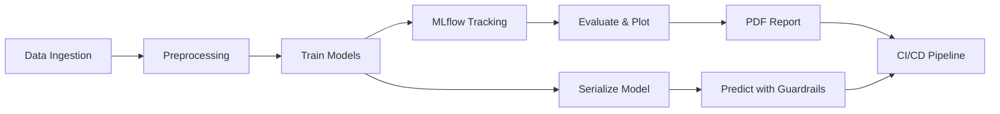

# 🏠 Housing Price Prediction (Regression)


## Problem Statement
What features most influence home sale prices, and how accurately can prices be predicted?

## Dataset
- **Source:** Ames Housing Dataset (Kaggle / De Cock, 2011) — 2,930 observations with 81 columns (80 features + `Sale_Price`). Far richer than the deprecated Boston Housing dataset.
- **Size:** 2,930 rows × 81 columns (after preprocessing and one-hot encoding, 300 encoded features + `SalePrice`)
- **Description:** Residential home sales in Ames, Iowa (2006–2010). Covers structural attributes (square footage, basement quality, garage capacity), neighborhood, zoning, and condition ratings. Missing values occur in `Misc_Feature` (2,824 NaNs) and `Mas_Vnr_Type` (1,775 NaNs), which are imputed as `'Unknown'` during preprocessing (zero-valued `Lot_Frontage` and `'No_Garage'` `Garage_Type` entries are pre-encoded in this mirror).

## Skills Demonstrated
Regression modeling, feature selection, handling missing data, residual analysis, MLOps pipeline design, CI/CD automation, Pydantic guardrails, and professional PDF reporting.

## Deliverables
- Feature importance analysis with correlation heatmaps
- Linear regression and random forest models with RMSE comparison
- Residual plots showing model assumptions and limitations
- Clear explanation of which features a homeowner could change to increase value
- IEEE-formatted PDF research report generated via ReportLab Platypus
- MLflow experiment tracking with logged parameters, metrics, and serialized models

## Approach
1. **Data Cleaning & EDA** — Identifier and sparse columns (`Id`, `PID`, `Alley`, `PoolQC`, `Fence`, `MiscFeature`) dropped if present. Numeric missing values filled with column median; categorical missing values filled with `'Unknown'`. Target column `Sale_Price` renamed to `SalePrice`.
2. **Feature Engineering** — One-hot encoding of categorical variables (`drop_first=True` for training, `drop_first=False` with training-column reindexing for single-row Streamlit inference). Highly correlated features identified via heatmap analysis.
3. **Modeling** — Baseline Linear Regression vs. ensemble Random Forest Regressor. Random Forest selected for its ability to capture non-linear interactions without polynomial feature engineering.
4. **Evaluation** — RMSE on a held-out 20% test split. Feature importance via Mean Decrease in Impurity. Residual analysis for homoscedasticity verification.

## Key Results
Holdout 20% test split (`n=586`, `random_state=42`):

| Metric | Linear Regression | Random Forest |
|--------|-------------------|---------------|
| RMSE | $29,026.76 | $28,471.76 |
| Relative Error (vs Median $160,000) | 18.14% | 17.79% |
| MAE | $16,478.20 | $16,641.57 |
| R² | 0.8949 | 0.8989 |
| MAPE | 8.99% | 9.31% |
| Standard Homes RMSE (<$400k, `n=566`) | $24,690.27 | $24,242.60 |
| Luxury Homes RMSE (≥$400k, `n=20`) | $86,225.57 | $84,378.68 |

## Key Findings
1. **Top numeric linear predictors:** Above-ground living area (`Gr_Liv_Area`, `r=0.7068`), garage car capacity (`Garage_Cars`, `r=0.6476`), garage area (`Garage_Area`, `r=0.6401`), and basement area (`Total_Bsmt_SF`, `r=0.6325`) have the highest Pearson correlation with `Sale_Price`.
2. **Top Random Forest MDI features:** `Garage_Cars` (29.78%), `Gr_Liv_Area` (14.95%), `Year_Built` (10.89%), `Exter_Qual_Typical` (6.75%), `First_Flr_SF` (5.38%), and `Total_Bsmt_SF` (5.36%) dominate tree impurity reduction.
3. **Ordinal one-hot dilution & segment error:** Because `Overall_Qual` is stored as text categories and one-hot encoded into 9 sparse dummy columns, its split importance is diluted across individual dummies. Luxury homes (`≥$400k`) exhibit 3.48× higher Random Forest RMSE than standard homes (`$84,379` vs. `$24,243`) due to sparse upper-tail coverage.

## How to Run
```bash
# 1. Clone and set up virtual environment
git clone https://github.com/GaneshArwan/housing_price_prediction.git
cd housing_price_prediction
python -m venv venv
venv\Scripts\activate        # Windows
# source venv/bin/activate   # macOS/Linux

# 2. Install dependencies
pip install -r requirements.txt

# 3. Train the model (with MLflow tracking)
python -m src.train

# 4. Generate evaluation plots
python -m src.evaluate

# 5. Generate IEEE PDF report
python -m src.generate_pdf_report

# 6. Run predictions with guardrails
python -m src.predict

# 7. Launch Streamlit dashboard
streamlit run app.py

# 8. Or run via Docker
docker build -t housing-price-predictor . && docker run -p 8501:8501 housing-price-predictor

# 9. Run tests
pytest
```

## Files
```
housing_price_prediction/
├── .github/workflows/
│   └── ml_pipeline.yml          # CI/CD pipeline (pytest + bandit + PDF)
├── data/
│   └── ames_housing.csv         # Static dataset (CI-safe, no network calls)
├── models/                      # Generated at train time (gitignored)
│   ├── linear_regression.joblib # Serialized baseline linear model
│   └── random_forest.joblib     # Serialized trained Random Forest model
├── notebooks/
│   └── analysis.ipynb           # Exploratory data analysis notebook
├── reports/figures/
│   ├── correlation_heatmap.png  # Top feature correlations
│   ├── feature_importance.png   # Random Forest MDI importances
│   ├── residual_plot.png        # Predicted vs actual residuals
│   └── Housing_Price_Prediction_Report.pdf  # IEEE formatted report
├── src/
│   ├── __init__.py
│   ├── config.py                # Pydantic-based configuration schemas
│   ├── data_loader.py           # Data ingestion and preprocessing
│   ├── evaluate.py              # Plot generation (heatmap, importance, residuals)
│   ├── format_utils.py          # Locale-aware currency and RMSE formatting
│   ├── generate_pdf_report.py   # IEEE two-column PDF via ReportLab Platypus
│   ├── guardrails.py            # Pydantic prediction boundary validation
│   ├── predict.py               # Model inference with guardrails
│   └── train.py                 # Training with MLflow tracking
├── tests/
│   ├── __init__.py
│   ├── test_app.py              # Streamlit UI integration tests
│   ├── test_data_loader.py      # Data ingestion unit tests
│   ├── test_evaluate.py         # Directory/artifact path tests
│   ├── test_guardrails.py       # Boundary validation tests
│   ├── test_predict.py          # Inference, allowlist, and formatter tests
│   └── test_train.py            # Config and Pydantic validation tests
├── .dockerignore                # Docker build context exclusions
├── .gitignore
├── app.py                       # Interactive Streamlit dashboard
├── conftest.py                  # Shared pytest path setup
├── Dockerfile                   # Container image for Streamlit app
├── LICENSE
├── pyproject.toml               # Pytest and project metadata
├── README.md
└── requirements.txt
```

## MLOps Workflow



## Methodology & Limitations
This project uses a straightforward supervised regression approach on the Ames Housing Dataset. The Random Forest Regressor was chosen as the primary model due to its robustness against overfitting and its native ability to rank feature importances via Mean Decrease in Impurity. All experiments are tracked through MLflow, ensuring full reproducibility of training runs, hyperparameters, and serialized model artifacts.

The primary limitation is **luxury home pricing volatility**. For properties at or above $400,000 (`n=20` in the test split), Random Forest RMSE rises from $24,243 to $84,379 (3.48× higher) as upper-tail comparables become sparse. This is expected, as ultra-high-end homes depend on custom attributes not captured in the 80 explanatory variables.

Additionally, the dataset is geographically limited to Ames, Iowa (2006–2010), which means the model should not be generalized to other housing markets without retraining. Future improvements include ordinal encoding for quality ratings, log-transforming `SalePrice`, gradient boosting methods (XGBoost/LightGBM), and a FastAPI serving layer for real-time predictions.
